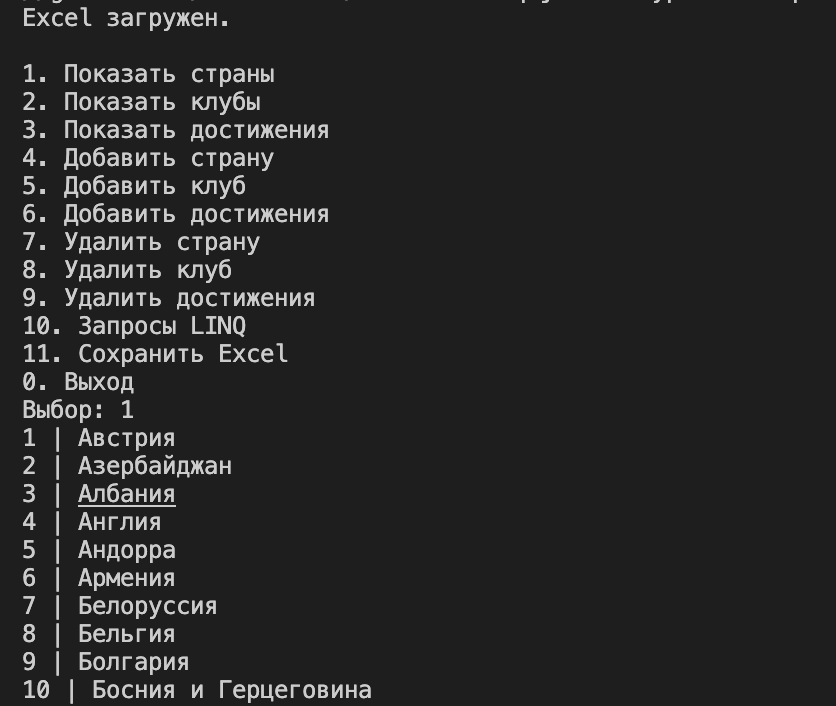
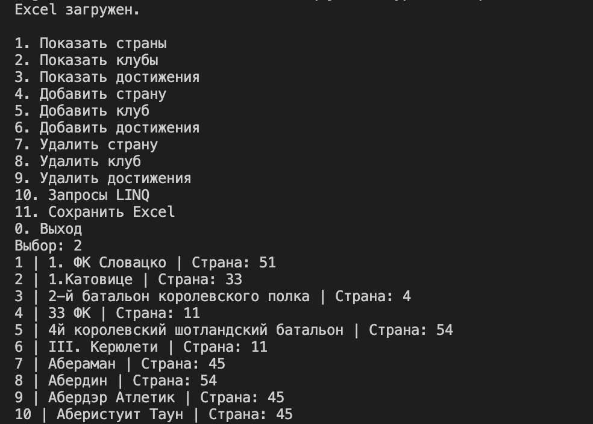
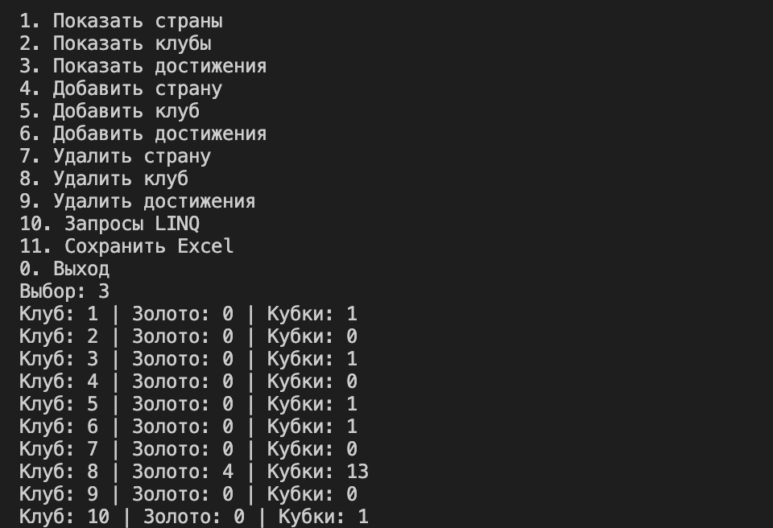
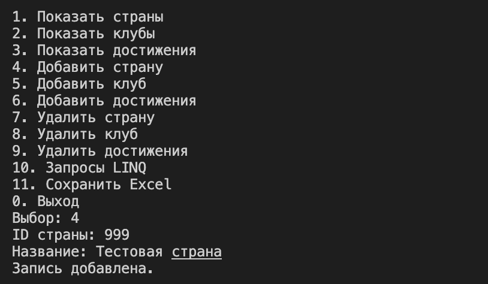
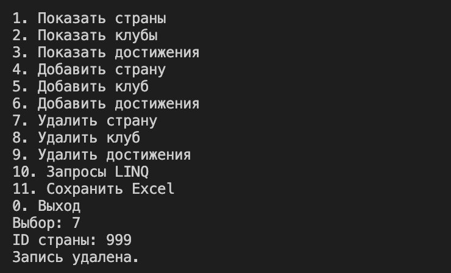
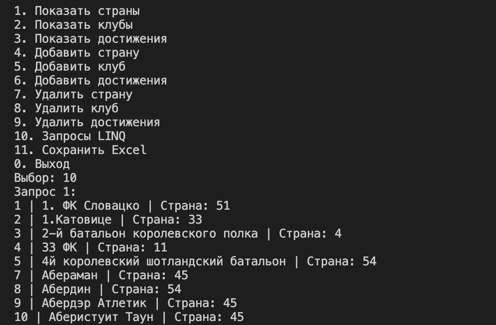
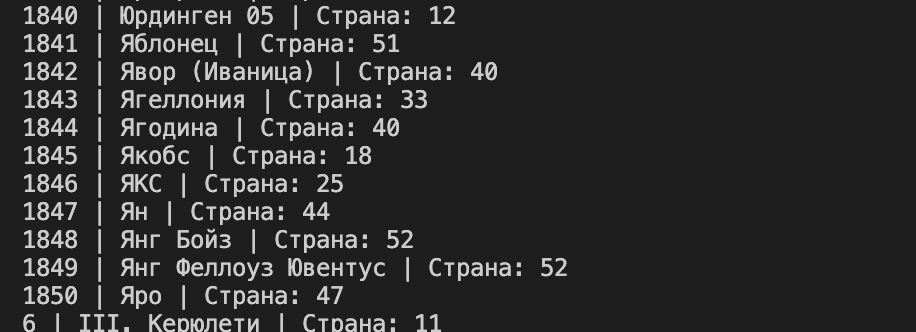
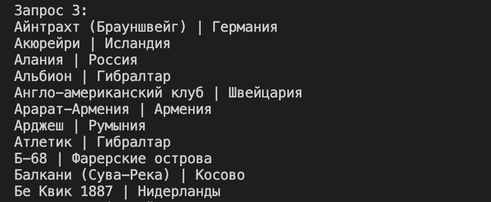
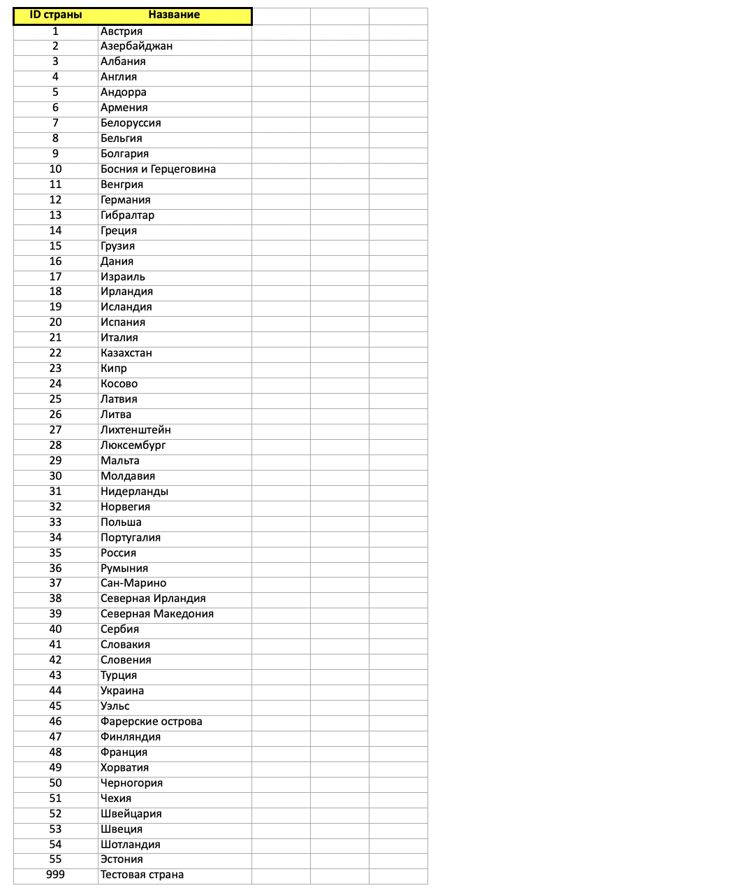

# Казанцев Иван ЛА-2 Лабораторная №5 Вариант 5

---

# Задание 1

## База данных «Европейские футбольные клубы»

### Текст задачи

В файле LR5-var5.xls приведён фрагмент базы «Европейские футбольные клубы» с данными на 1
января 2023 года. База данных состоит из трёх таблиц. Схема базы данных приведена на рисунке.

Таблица «Страны» содержит информацию о всех странах-членах UEFA. Таблица «Клубы» содержит
информацию о всех клубах, выигрывавших медали или кубки как внутри страны, так и на
европейской арене. Таблица «Достижения» отражает информацию о всех выигранных клубом за
время его существования медалях и трофеях, учитываемых национальной федерацией. Учитываются
также достижения официальных предшественников клуба, а также медали и кубки, выигранные в
чемпионатах несуществующих стран (СССР, ГДР, Чехословакия, Югославия), либо во время участия в
чемпионатах и кубках других стран. Столбцы З,С,Б содержат информацию о золотых, серебряных и
бронзовых медалях, выигранных в национальном чемпионате. Столбцы К и ФК содержат информацию
о выигранных и проигранных соответственно финалах национальных кубков (учитывая проводимый
или проводившийся в некоторых странах Кубок Лиги). Буква Ф здесь и далее проигрыш в финале.
Остальные столбцы содержат информацию о выигранных и проигранных финалах европейских
кубков (Лиги Чемпионов/Кубке европейских чемпионов – ЛЧ и ФЛЧ, Лиге Европы/Кубке УЕФА – ЛЕ и
ФЛЕ, Кубке обладателей кубков – КОК и ФКОК, Лиге Конференций – ЛК и ФЛК).

Пример запроса:
Определите клубы, которые побеждали в чемпионате страны, но ни разу не выиграли национальный
кубок. Из этих клубов выберите клуб с наибольшим количеством побед в чемпионате страны. В ответе
укажите ID страны, которую он представляет. Если таких клубов несколько, выберите наибольший ID
страны.

Ответ: 47

База данных хранится в Excel-файле `LR5-var5.xls` и состоит из трех таблиц:

- **Страны** — содержит идентификаторы и названия стран.
- **Клубы** — содержит идентификаторы клубов, их названия и идентификаторы стран, которые они представляют.
- **Достижения** — содержит информацию о количестве выигранных и проигранных финалов различных национальных и европейских турниров.

Программа должна обеспечивать чтение базы данных из Excel-файла, просмотр таблиц, добавление и удаление записей по ключу, выполнение четырех LINQ-запросов и сохранение изменений в Excel-файле. Также необходимо предусмотреть обработку возможных ошибок при работе программы.

### Алгоритм решения

1. Создать классы `Country`, `Club` и `Achievement` для представления элементов базы данных.
2. Определить в классах необходимые поля и свойства.
3. Создать конструкторы для инициализации объектов.
4. Переопределить метод `ToString()` для вывода информации об объектах.
5. Создать вспомогательные классы для работы с базой данных, Excel-файлом и LINQ-запросами.
6. При запуске программы открыть Excel-файл `LR5-var5.xls`.
7. Прочитать данные с листов «Страны», «Клубы» и «Достижения».
8. Преобразовать прочитанные данные в объекты соответствующих классов.
9. Сохранить полученные объекты в списках `countries`, `clubs` и `achievements`.
10. Вывести главное меню программы с возможностью выбора выполняемого действия.
11. При выборе просмотра таблицы вывести все записи соответствующего списка.
12. При выборе добавления записи запросить необходимые данные, создать объект и добавить его в соответствующий список.
13. При выборе удаления записи запросить ключ объекта, найти запись с указанным ключом и удалить ее из списка.
14. При выборе выполнения LINQ-запросов выполнить четыре разработанных запроса и вывести полученные результаты.
15. При выборе сохранения Excel-файла записать текущие данные списков обратно в соответствующие листы.
16. Предусмотреть обработку ошибок при чтении и сохранении Excel-файла.
17. Завершить работу программы при выборе соответствующего пункта меню.

---

## Реализация LINQ-запросов

### Запрос 1

#### Текст задачи

Вывести перечень всех футбольных клубов, отсортированных по названию в алфавитном порядке.

#### Алгоритм решения

1. Получить список футбольных клубов.
2. Выполнить сортировку клубов по названию с помощью LINQ.
3. Преобразовать результат в список.
4. Вывести полученный перечень клубов.

---

### Запрос 2

#### Текст задачи

Определить количество футбольных клубов, связанных с существующими странами в базе данных.

#### Алгоритм решения

1. Получить список клубов.
2. Получить список стран.
3. Соединить таблицы «Клубы» и «Страны» по идентификатору страны.
4. Подсчитать количество полученных записей.
5. Вывести найденное количество.

---

### Запрос 3

#### Текст задачи

Определить перечень футбольных клубов, которые хотя бы один раз становились чемпионами национального чемпионата, но ни разу не выигрывали национальный кубок.

В ответе вывести название клуба и название страны, которую он представляет.

#### Алгоритм решения

1. Получить список клубов.
2. Получить список стран.
3. Получить список достижений клубов.
4. Соединить таблицы «Клубы» и «Страны» по идентификатору страны.
5. Соединить полученный результат с таблицей «Достижения» по идентификатору клуба.
6. Отобрать клубы, у которых количество золотых медалей больше нуля, а количество выигранных национальных кубков равно нулю.
7. Сформировать перечень названий клубов и соответствующих стран.
8. Вывести полученный список.

---

### Запрос 4

#### Текст задачи

Определить ID страны, которую представляет клуб с наибольшим количеством побед в национальном чемпионате среди клубов, которые хотя бы один раз становились чемпионами страны, но ни разу не выигрывали национальный кубок.

Если таких клубов несколько, выбрать страну с наибольшим ID.

#### Алгоритм решения

1. Получить список клубов.
2. Получить список стран.
3. Получить список достижений клубов.
4. Соединить таблицы «Клубы» и «Страны» по идентификатору страны.
5. Соединить полученный результат с таблицей «Достижения» по идентификатору клуба.
6. Отобрать клубы, у которых количество золотых медалей больше нуля, а количество выигранных национальных кубков равно нулю.
7. Отсортировать полученные записи по количеству золотых медалей в порядке убывания.
8. При одинаковом количестве золотых медалей отсортировать записи по ID страны в порядке убывания.
9. Получить ID страны из первой записи.
10. Вывести найденный ID страны.

---

## Тестирование

### Пример работы

### Просмотр базы данных

В результате было выведено **55 стран**.

В результате было выведено **1850 клубов**.

В результате было выведено **1850 записей о достижениях**.

### Добавление записи

В результате была успешно добавлена новая страна с ID 999 с названием «Тестовая страна». Программа вывела сообщение «Запись добавлена».

После добавления страна появилась в списке стран. Общее количество записей увеличилось с 55 до 56.

### Удаление записи

В результате была успешно удалена страна с ID 999. Программа подтвердила выполнение операции.

После удаления тестовая страна отсутствует в списке. Количество записей вернулось к исходному значению — 55 стран.

### Выполнение LINQ-запросов

В результате выполнения первого LINQ-запроса был получен список футбольных клубов, отсортированный по названию в алфавитном порядке. Запрос использует таблицу Clubs и возвращает список записей.

Всего было выведено 1850 клубов. Последним в списке отображается клуб «III. Керюлети», ID 6, страна 11.

В результате выполнения второго LINQ-запроса было получено количество клубов, связанных с соответствующими странами. Для выполнения запроса использовалось объединение таблиц Clubs и Countries.

Результат запроса — 1850 записей.

В результате выполнения третьего LINQ-запроса был получен список клубов, которые выиграли национальный чемпионат, но не выиграли национальный кубок.

В результате были выведены названия клубов и соответствующих стран.

В результате выполнения четвёртого LINQ-запроса была найдена страна с максимальным количеством побед в национальном чемпионате среди клубов, не выигравших национальный кубок.

При одинаковом количестве побед учитывается страна с наибольшим ID.

Результат запроса — ID страны 47.

### Сохранение Excel-файла

В ходе проверки была добавлена тестовая страна с ID 999 и названием «Тестовая страна». После добавления записи была выполнена команда сохранения данных в Excel. Программа сообщила об успешном сохранении файла.

В результате проверки тестовая запись появилась в Excel-файле. Это подтверждает корректную работу функции сохранения данных.

### Проверка обработки ошибок

При проверке обработки ошибок было введено некорректное значение вместо пункта меню. Программа обработала ошибку и предложила повторно ввести целое число, не завершив работу аварийно.

При попытке удалить запись с несуществующим ID программа сообщила об отсутствии такой записи. Проверка подтверждает корректную обработку ошибочных ситуаций.

---

